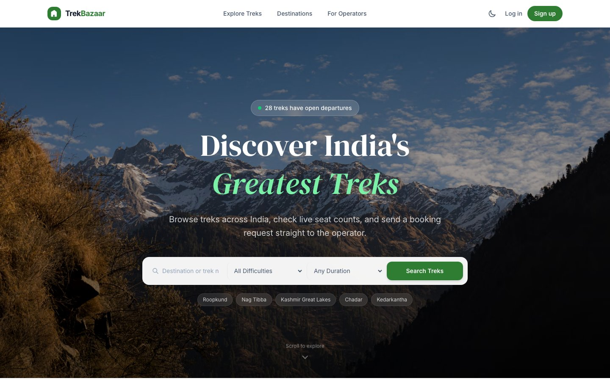
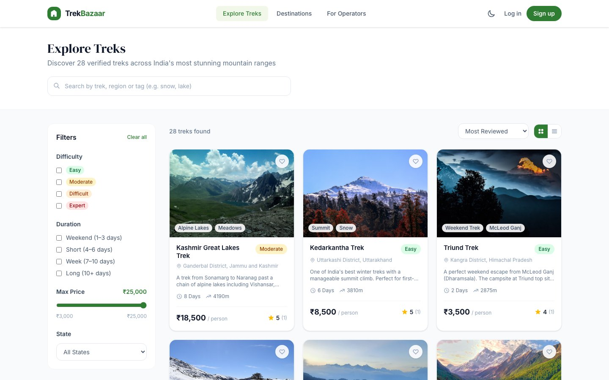
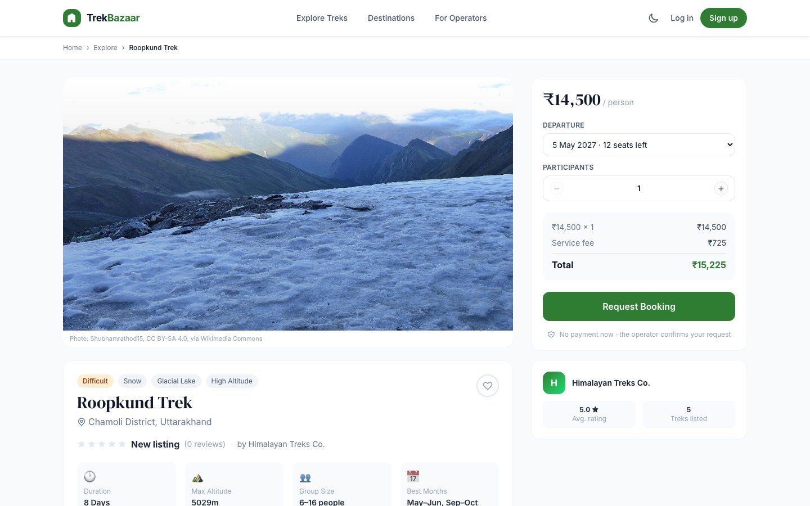
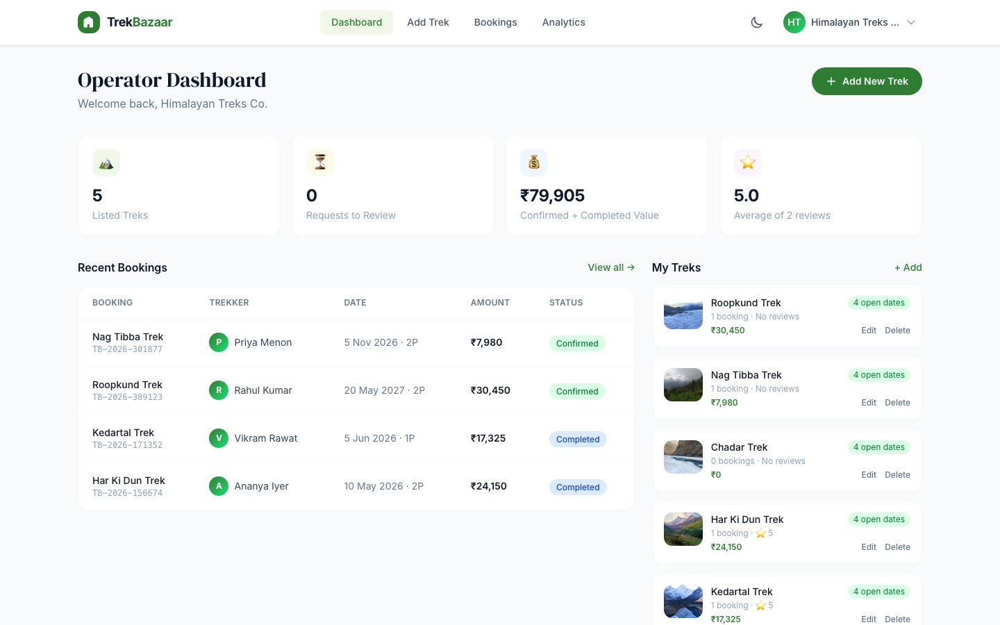

# TrekBazaar

A frontend for a trekking marketplace for Indian treks. Trekkers can browse, filter, wishlist and book treks. Operators can publish and manage listings. Admins can moderate users, operators and reviews.

It started as a Figma Make UI/UX export (19 static screens). This repo turns that export into a runnable app: it adds URL routing, shared state that survives a reload, form validation, and working versions of the buttons that did nothing in the design.

> Treks, bookings and user accounts are stored in MongoDB behind an Express REST API. Passwords are hashed with scrypt. Checkout takes no payment, there are no auth tokens on the API yet, and messages, emails and SMS are simulated with on-screen notices.

Live: **https://trekbazaar-eta.vercel.app** (Vercel, with MongoDB Atlas). The demo data is shared, so bookings made there are visible to everyone.



| Explore | Trek details | Operator dashboard |
|---|---|---|
|  |  |  |

## What works

**Trekkers**
- Search from the landing page, or use the quick tags and destination tiles. All of them open Explore pre-filtered.
- On Explore, filter by text, difficulty, duration, maximum price and state. Sort the results, and switch between grid and list views.
- The trek page has a gallery, tabs (overview, itinerary, inclusions, reviews), a departure picker and a live price breakdown.
- Booking is a three-step flow: choose a batch, enter traveller details, then pay by card, UPI or net banking. Each step is validated. The booking is saved and appears on the dashboard and in My Bookings.
- The confirmation page shows the real booking. You can download a receipt as a `.txt` file.
- My Bookings has status filters, and you can cancel a booking (with a confirm step).
- The wishlist is shared across every screen and kept after a reload.
- Settings: edit your profile and preview a photo; password validation; notification and 2FA toggles; region preferences; appearance / dark mode toggle; a reset for the demo data.

**Design & Theme Enhancements**
- **Dark Mode**: Complete system-wide dark mode support with automatic system preference detection (`prefers-color-scheme`), quick toggle in the top navigation bar, mobile menu switcher, and settings preference option. Preference is persisted in `localStorage`.
- **Refined Micro-Interactions**: Smooth card hover elevation lifts (`hover:-translate-y-1 hover:shadow-xl`), active button feedback animations, polished search controls, and customized scrollbar aesthetics.
- **Accessible Contrast**: High-contrast dark theme tokens tailored for optimal readability across all 19 screens, form controls, tables, badges, and modals.

**Operators**
- Add or edit a trek, with per-field validation. A published trek appears on Explore right away and can be booked.
- Booking management: search, status filters, and confirming pending bookings. Bookings you make as a trekker on this operator's treks show up here.
- Revenue analytics with a working 3M / 6M / 12M period switch (sample data).

**Admins**
- User management: search, filter, suspend and reinstate.
- Operator verification: approve, reject and revoke, with each list updating.
- Review moderation: approve, flag and reject.

**Across the app**
- Hash-based URLs (`#/trek-details?trek=3`). Deep links, the browser Back button and page refresh all work, and the app runs on any static host with no server rewrites.
- Opening a role-specific screen by URL switches the demo role. You can also use the **View as** switcher in the navbar.
- Responsive at phone widths (checked at 381px for every screen). Wide tables scroll horizontally inside their card instead of overflowing the page.
- Accessibility basics: labelled inputs, `aria-pressed` and `aria-expanded` on toggles, keyboard-reachable trek cards, error messages announced with `role="alert"`, and the hero's bounce animation turns off under `prefers-reduced-motion`.

## Run it

Requires Node.js 22.18 or later and MongoDB running locally (default `mongodb://127.0.0.1:27017/trekbazaar`, override with `MONGO_URI`). The seed script and tests import the TypeScript seed data directly through Node's built-in type stripping.

```bash
npm install
npm run seed       # load the demo treks, bookings and accounts into MongoDB
npm run server     # Express API on http://localhost:4000
npm run dev        # http://localhost:5173 (proxies /api to the server)
npm test           # unit tests + API integration tests (uses the trekbazaar_test database)
npm run build      # type-check + production build into dist/
npm run preview    # serve the production build
```

## Deploy (Vercel)

`vercel.json` builds the Vite frontend as static files and serves the Express app as one serverless function (`api/index.js`), with `/api/*` rewritten to it. The function needs a hosted MongoDB, for example a free MongoDB Atlas cluster that allows connections from `0.0.0.0/0`, since Vercel functions have no fixed IP.

```bash
vercel link
vercel env add MONGO_URI production   # Atlas connection string, including /trekbazaar as the database
MONGO_URI='<atlas uri>' npm run seed
vercel deploy --prod
```

Vercel compiles `.ts` files to `.js` without rewriting import paths, so server code imports `src/pricing.js` (plain JS) rather than `src/lib.ts`.

## Project structure

```
src/
  App.tsx            hash router: maps routes to screens, sets the page title, renders the toast
  router.ts          parseHash / toHash (used with react-router-dom's HashRouter)
  api.ts             axios instance and error-message helper
  store.tsx          React context: loads treks and bookings from the API; user, role, wishlist and theme in localStorage
  lib.ts             pure helpers: INR formatting, dates, departure batches, validators
  pricing.js         price breakdown, booking ids and limits, shared with the server
  logic.test.ts      node:test suite for router.ts and lib.ts
  data/treks.ts      seed treks and destinations
  components/        Navbar, Footer, TrekCard
  screens/           one file per screen (19)
api/index.js         Vercel serverless entry: reuses one MongoDB connection, then hands off to the Express app
server/
  index.js           Express app: JSON body parsing, request log, routes, 404 and error handler
  models.js          Mongoose schemas: Trek, Booking, User
  routes.js          REST routes for /api/treks, /api/bookings, /api/users
  seed.js            resets the database to the demo data
  api.test.js        node:test integration tests against a real MongoDB
postman/             Postman collection for every endpoint
```

The stack is MongoDB, Express 5, React 19 and Node.js (MERN), with Mongoose 9, axios, react-router-dom 7, TypeScript, Vite 8 and Tailwind CSS v4.

Demo accounts (password `trek1234`): `rahul.kumar@example.com` (trekker), `operator@trekbazaar.in` (operator), `admin@trekbazaar.in` (admin).

## API

| Method | Endpoint | Purpose |
|---|---|---|
| GET | `/api/treks` | List treks (`?state=`, `?difficulty=`, `?operatorId=`) |
| GET | `/api/treks/:id` | One trek |
| POST | `/api/treks` | Publish a trek |
| PUT | `/api/treks/:id` | Edit a trek |
| DELETE | `/api/treks/:id` | Delete a trek (409 if it has active bookings) |
| GET | `/api/bookings` | List bookings (`?email=`, `?status=`) |
| GET | `/api/bookings/:id` | One booking |
| POST | `/api/bookings` | Create a booking; the server computes the amount |
| PATCH | `/api/bookings/:id` | Change status (confirm, cancel, complete) |
| DELETE | `/api/bookings/:id` | Delete a booking |
| POST | `/api/users/register` | Create an account |
| POST | `/api/users/login` | Check email and password |
| GET | `/api/users` | List users (no password hashes) |
| PUT | `/api/users/:id` | Update a profile |

## Changes from the original design

The visual identity is kept as it was: forest-green palette, DM Serif Display headings, card layouts, and the emoji used as icons. The main changes:

- Replaced the floating "20 screens" demo navigator with real navigation and a **View as** role switcher.
- Booking dates were hardcoded to 2025. Departures are now generated relative to today.
- The confirmation page showed a fixed Roopkund booking whatever you had booked. It now shows the booking you just made.
- The wishlist was separate state on each screen. It is now shared and persisted.
- The Explore filter sidebar was a component defined inside render, so it remounted on every keystroke and broke dragging the price slider. Fixed.
- Removed the Figma Make tooling (`.figma/`, its Vite plugins, the oxfmt formatter).


 The UI design comes from a Figma Make export.
